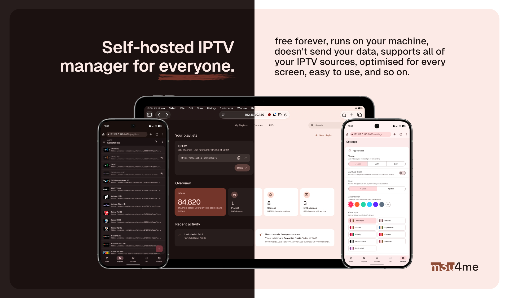

<p align="center">

</p>
<h3 align="center">m3u4me: Self-hosted M3U playlist manager</h3>
<p align="center">
m3u4me is your IPTV playlists' new home. Your streams don't leave your local network, you are in charge, nobody can see or control your playlists.
</p>
<p align="center">
<a href="LICENSE"></a>
<a href="docs/install.md#option-2-docker"></a>
<a href="docs/about.md"></a>
<a href="https://github.com/andrei-savin/m3u4me/commits/main"></a>
<a href="https://github.com/andrei-savin/m3u4me/stargazers"></a>
</p>
<p align="center">
<a href="docs/install.md"><b>Install</b></a> ·
<a href="docs/README.md"><b>Help pages</b></a> ·
<a href="docs/features.md"><b>Features</b></a> ·
<a href="docs/troubleshooting.md"><b>Troubleshooting</b></a> ·
<a href="#ai-disclosure"><b>AI disclosure</b></a>
</p>
<br/>

> [!WARNING]
> m3u4me does NOT provide ANY streams! It is purely a M3U playlist manager. You must bring your own content.

> [!NOTE]
> This app aims to be a self-hosted alternative to https://m3u4u.com/ - as you can see, m3u4me's name is obviously referencing them. The projects are not related in any way. No harm intended!

## AI Disclosure

> [!NOTE]
> This app's code was AI-generated, with minor interventions from me. I am a graphic designer with very limited coding knowledge; I do not support pointless usage of AI and I am fully aware of the harm it can cause. <br/><br/> m3u4me started out as something that was intended only for personal use - I am sharing it only because I believe it is an useful app which might help many other IPTV enthusiasts. <b>It will always be entirely free</b>. <br/><br/> I fully encourage any developer who comes across this app and wants to turn it into something human-made, without AI involvement. </br></br> AI was not used for <b>anything</b> else besides writing the actual code of the app.

## Get started in 3 steps

**1. Install it.** On a Linux server (Debian, Ubuntu, Fedora, or a Proxmox container based on them), paste this into the terminal:
```bash
curl -fsSL https://raw.githubusercontent.com/andrei-savin/m3u4me/main/install.sh | sudo bash
```

**2. Open it.** When the install is done, it prints an address like `http://192.168.1.50:8080`. Open that address in a browser on any device in your home.

**3. Follow the setup.** A short setup walks you through adding your provider and TV guide, an optional password, and your first playlist.

Not on Linux, or prefer Docker? See [all the ways to install m3u4me](docs/install.md).

## Help pages

| | Page | Read this if… |
| :-: | --- | --- |
| 📦 | [Install](docs/install.md) | You want to get m3u4me running. |
| 👋 | [First steps](docs/first-steps.md) | You just installed it and want to make your first playlist. |
| 📺 | [Use it in your TV app](docs/tv-app.md) | You have a playlist and want to watch it on your TV, phone or computer. |
| ✨ | [Features](docs/features.md) | You want to know everything m3u4me can do. |
| 🔄 | [Updating](docs/updating.md) | A new version is out. |
| 💾 | [Backup & moving to a new server](docs/backup.md) | You want a copy of everything, or you're moving m3u4me. |
| 🔒 | [Password & recovery key](docs/password.md) | You want to lock m3u4me, or you forgot your password. |
| 🛠️ | [Troubleshooting](docs/troubleshooting.md) | Something isn't working. |
| 📖 | [Glossary](docs/glossary.md) | A word like EPG, TVG ID or Xtream Codes doesn't make sense. |
| ℹ️ | [About](docs/about.md) | You want to know who made this and how. |

## What it can do

- **[Many playlists](docs/features.md#playlists-and-channels)**, each with a short, easy-to-type link like `http://IP:port/1`.
- **[Channel sources](docs/features.md#sources)**: connect your Xtream Codes account, a playlist link or a file, then pick the channels you want.
- **[Channel sync](docs/features.md#channel-sync)**: channels stay up to date when your provider changes their links, names or logos.
- **[TV guide (EPG)](docs/features.md#tv-guide-epg)**: browse what's on, and match your channels to the guide automatically.
- **[Printable channel list](docs/features.md#printable-channel-list)**: turn any playlist into a neat A4 PDF.
- **[Backup & restore](docs/backup.md)**: everything in one file, ready to move to a new server.
- **[Search everything at once](docs/features.md#search-and-shortcuts)**, with keyboard shortcuts for the busy bits.
- **[Works on your phone too](docs/features.md#on-your-phone)**, with a layout made for touch screens.
- **[Light, dark and AMOLED themes](docs/features.md#look-and-feel)** that follow your device's light/dark setting, Material You style: the whole app is coloured from your favourite accent colour.

Everything saves by itself, and an accidental delete can be undone.

## Bug reports & feature requests
If you encounter any AI slop, or other sort of error, feel free to create a GitHub issue. I will reply ASAP.
</br>You can also open issues for any feature requests. However, I can not guarantee that they will be accepted.
